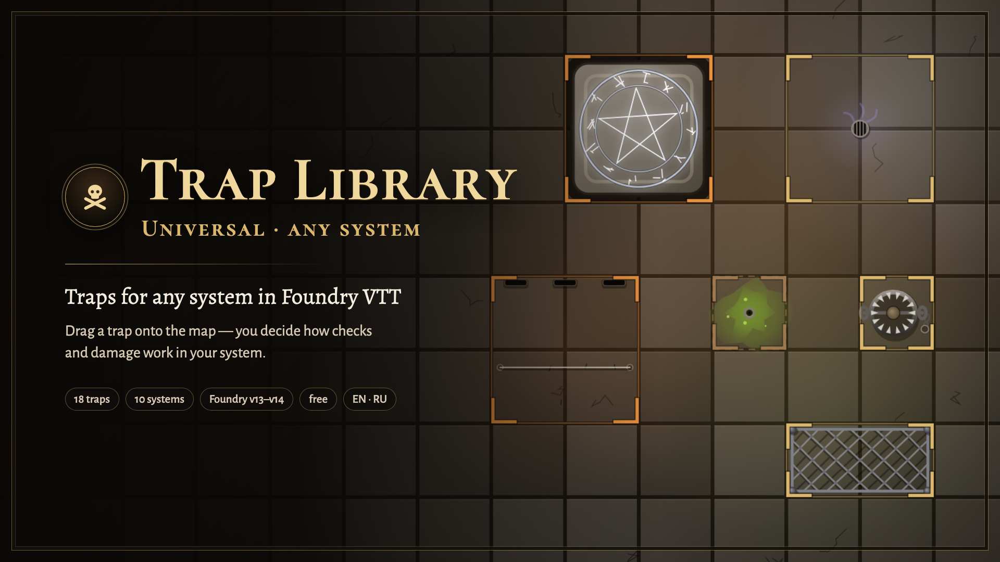

# Западня · Universal · Trap Library · Universal

| 🐉 [D&D 5e](https://github.com/klimenkoyg/foundry-traps) | 🧭 [Pathfinder 2e](https://github.com/klimenkoyg/foundry-traps-pf) | 🎲 **Any system / Любая система** |
|:---:|:---:|:---:|
| [Русский](https://github.com/klimenkoyg/foundry-traps#readme) · [English](https://github.com/klimenkoyg/foundry-traps/blob/main/README.en.md) | [Русский](https://github.com/klimenkoyg/foundry-traps-pf#readme) · [English](https://github.com/klimenkoyg/foundry-traps-pf/blob/main/README.en.md) | [Русский](README.md) · **English** |



A trap library with animations and sounds for **any system** in Foundry VTT. The GM drags a trap
onto the map — it becomes a hidden region that fires when a character steps in: an effect on the
scene, a save or an attack, damage, a condition and a chat card.

The module knows nothing about your system — you decide how checks work in the **Rules** window.
It's the same Trap Library as the D&D 5e and PF2e versions: the same 18 traps, animations, sounds,
triggers and map buttons.

## Installation

In Foundry: **Add-on Modules → Install Module**, paste the manifest URL at the bottom:

```
https://github.com/klimenkoyg/foundry-traps-universal/releases/latest/download/module.json
```

Foundry VTT **v13–v14**, any system. No other modules needed; optionally
[Sequencer](https://foundryvtt.com/packages/sequencer) and the free
[JB2A](https://foundryvtt.com/packages/JB2A_DnD5e).

## Getting started

**You don't have to configure anything.** Traps work right away: damage goes to the token's HP bar
(HP in almost any system) and players type their roll bonus into a small dialog.

To have bonuses come from the sheet automatically, there are three helpers — all in the **Rules**
window (it opens the first time the GM enters a world; later — the ⚖ Rules button in the library
window or **Settings → Trap rules**):

1. **The module already knows your system** — its rules are filled in, just save. Right now:
   Shadowdark, Old-School Essentials, Dungeon Crawl Classics, Dragonbane, Black Flag / Tales of the
   Valiant, Level Up Advanced 5e, Starfinder Second Edition, Call of Cthulhu 7e, Daggerheart and Savage Worlds (in Savage Worlds
   the GM marks outcomes and damage: it uses trait dice instead of numbers).
2. **Find on sheet** — select a character token and click the button: the module finds where saves,
   skills, AC and HP live on the sheet and fills in the paths. "Check on the selected token" shows
   the numbers.
3. **A preset** — one click:

- **Generic d20** — `1d20 + bonus ≥ DC`, half damage on a success, players roll their own saves with
  a button in the card, damage goes to the token's HP bar. Fits most d20 systems.
- **GM only** — the module rolls nothing for characters: each target in the card gets Success /
  Failure buttons, damage and conditions are applied with a button. Works in any system, even
  without a d20.

You can **save your rules to a file** and **load** them — to share a setup for your system or move
it to another world.

## Advanced settings

Everything below is tucked under "Advanced settings" — usually you don't need to look there.

**Who rolls saves:** the module · the player with a button in the card · the player rolls their own
way and **enters the result** · the **GM marks** the outcome. Also switchable on the On this scene tab.

**Checks:**
- **Formula** — `1d20 + @bonus`, `2d6 + @bonus`, `1d100`…
- **Success if the result is** at least the target (d20) or **at most** the target (d100, roll-under).
- **Compare against:** the trap's DC or **a number from the character sheet** (OSR saving throw
  targets).
- **Crits:** none · highest die face one step better, a 1 one step worse · plus ±10 from the target
  (like PF2e). Optionally a critical failure on a save and a critical hit deal double damage.
- **Bonus:** a path to a number on the sheet; with no path — ask the player in a small dialog, or 0.
  Paths can be added with "+" (skill + ability mod) and given a fallback with "|" (no skill — use
  the ability).
- **Own formula and comparison for a single check** — for systems where they differ (OSE: saves are
  d20 ≥ target, finding traps is 1d6 ≤ skill).

**Saves and skills** — your own lists: key, name, bonus path (`system.abilities.dex.save`). Catalog
traps use categories — *dodge*, *endure*, *resist with the mind*, *notice*, *mechanism*, *brute
force*, *magic* — and you map each to one of your saves or skills. The **Check on the selected
token** button shows which numbers the paths find.

**Damage and hit points:** to the token's bar (bar1 — usually HP; the system handles temp HP if it
can) · a custom path · nowhere (the GM subtracts it). Damage types are labels, no resistances. The AC
path is for traps with an attack; without it the GM marks hit or miss.

**Conditions** come from your system. Catalog traps want prone, restrained, poisoned… — the module
looks for the same ones in your system; you can map them by hand. If the system has no such
condition, it stays as words in the card.

**Noticing:** off · a passive number from the sheet vs DC · a secret skill check (once per trap).
**Disarming:** "a failure by N or more sets it off" (0 — never); in GM mode — a Disarmed / Didn't
work / Set it off dialog.

### Finding a path to a number on the sheet

Select a token and open the browser console (F12): `canvas.tokens.controlled[0].actor.system` shows
where abilities, saves and hit points live. Paths start from the actor: `system.attributes.hp`,
`system.abilities.dex.mod`. If there's an object with `value`, `total` or `mod`, the module picks it
up. Check with the **Check on the selected token** button.

## Not included

- Damage scaling by party level — every system does it differently: write your own numbers.
- Damage resistances and vulnerabilities.
- The system's own roll dialog (advantage, modifiers) — that's what "player enters the result" is for.

## Development

```bash
npm test        # trap rules without Foundry
npm run check   # syntax, translations, templates, manifest files
npm run build   # dist/module.zip and dist/module.json
```

Bench with a mock of Foundry and an "unknown" system: `python3 scripts-dev/serve.py`, then
`http://localhost:8766/dev/harness/?lang=en`.

## Ideas and bugs

The "Suggest an idea" button at the bottom of the window (GM only), or
[Issues](https://github.com/klimenkoyg/foundry-traps-universal/issues). Ready-made rules for your
system are especially welcome — save them to a file and send them over.

## Rights

© 2026 Yuriy Klimenko. You may use the module for free in any games, including paid ones, and share
it — whole and unchanged. Changing the code, taking parts into other modules or selling it requires
the author's written consent. Configuring traps and rules and saving your own in the module window is
use, not modification. Full terms are in [LICENSE](LICENSE). Trap texts, animations and sounds are
original.
