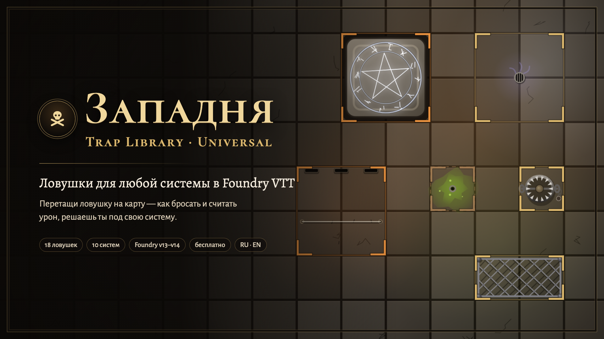

# Западня · Universal · Trap Library · Universal

| 🐉 [D&D 5e](https://github.com/klimenkoyg/foundry-traps) | 🧭 [Pathfinder 2e](https://github.com/klimenkoyg/foundry-traps-pf) | 🎲 **Any system / Любая система** |
|:---:|:---:|:---:|
| [Русский](https://github.com/klimenkoyg/foundry-traps#readme) · [English](https://github.com/klimenkoyg/foundry-traps/blob/main/README.en.md) | [Русский](https://github.com/klimenkoyg/foundry-traps-pf#readme) · [English](https://github.com/klimenkoyg/foundry-traps-pf/blob/main/README.en.md) | **Русский** · [English](README.en.md) |



Библиотека ловушек с анимациями и звуками для **любой системы** в Foundry VTT. Ведущий
перетаскивает ловушку на карту — она встаёт скрытой областью и срабатывает, когда на неё наступает
персонаж: эффект на сцене, спасбросок или атака, урон, состояние и карточка в чате.

Модуль ничего не знает о вашей системе — как бросать и считать, решаете вы в окне **«Правила»**.
Это та же «Западня», что для D&D 5e и PF2e: те же 18 ловушек, анимации, звуки, триггеры и кнопки на
карте.

## Установка

В Foundry: **Модули → Установить модуль**, внизу окна вставить адрес манифеста:

```
https://github.com/klimenkoyg/foundry-traps-universal/releases/latest/download/module.json
```

Foundry VTT **v13–v14**, любая система. Сторонние модули не нужны; по желанию —
[Sequencer](https://foundryvtt.com/packages/sequencer) и бесплатный
[JB2A](https://foundryvtt.com/packages/JB2A_DnD5e).

## С чего начать

**Можно ничего не настраивать.** Ловушки сразу работают: урон идёт в полоску хитов токена (почти
в любой системе это хиты), а бонус к броску игрок вписывает в маленьком окошке.

Чтобы бонусы брались из листа сами, есть три помощника — все в окне **«Правила»** (откроется при
первом входе в мир; потом — кнопка ⚖ «Правила» в окне библиотеки или **Настройки → Правила ловушек**):

1. **Ваша система уже знакома модулю** — правила для неё подставлены сами, остаётся сохранить.
   Сейчас это Shadowdark, Old-School Essentials, Dungeon Crawl Classics, Dragonbane, Black Flag /
   Tales of the Valiant, Level Up Advanced 5e, Starfinder Second Edition, Call of Cthulhu 7e, Daggerheart и Savage Worlds
   (в Savage Worlds исход и урон отмечает ведущий: там кубики черт вместо чисел).
2. **«Найти в листе»** — выделите токен персонажа и нажмите кнопку: модуль сам найдёт, где в листе
   спасброски, навыки, КД и хиты, и подставит пути. «Проверить на выделенном токене» покажет числа.
3. **Пресет** — одной кнопкой:

- **Обычный d20** — `1d20 + бонус ≥ Сл`, успех — половина урона, игроки бросают сами кнопкой в
  карточке, урон — в полоску хитов токена. Подходит большинству d20-систем.
- **Только ведущий** — модуль ничего не бросает за персонажей: у каждой цели в карточке кнопки
  «Успех / Провал», урон и состояние — по кнопке. Работает в любой системе, даже без d20.

Готовые правила можно **сохранить в файл** и **загрузить** — чтобы поделиться настройкой под свою
систему или перенести её в другой мир.

## Расширенные настройки

Всё ниже спрятано под «Расширенные настройки» — обычно туда заглядывать не нужно.

**Кто бросает спасброски:** модуль сам · игрок кнопкой в карточке · игрок бросает как привык и
**вводит итог** · **ведущий отмечает** исход. Это же переключается на вкладке «На этой сцене».

**Проверки:**
- **Формула** — `1d20 + @bonus`, `2d6 + @bonus`, `1d100`…
- **Успех, если итог** не меньше цели (d20) или **не больше** (d100, «бросить меньше»).
- **С чем сравнивать:** Сл ловушки или **число из листа персонажа** (цели спасбросков в OSR).
- **Криты:** нет · максимум кубика на ступень лучше, единица — хуже · ещё и ±10 от цели (как в PF2e).
  По галочке крит. провал спасброска и крит атаки — урон вдвое.
- **Бонус:** путь к числу в листе; пути нет — спросить у игрока в окошке или 0. Пути можно
  складывать через «+» (навык + модификатор) и давать запасной через «|» (нет навыка — характеристика).
- **Своя формула и сравнение у отдельной проверки** — для систем, где они разные (OSE: спасбросок
  d20 ≥ цели, поиск ловушки 1d6 ≤ навыка).

**Спасброски и навыки** — свои списки: ключ, название, путь к бонусу (`system.abilities.dex.save`).
Ловушки каталога пользуются категориями — *увернуться*, *выдержать*, *устоять разумом*, *заметить*,
*механизм*, *сила*, *магия*, — и вы сопоставляете каждую своему спасброску или навыку.
Кнопка **«Проверить на выделенном токене»** показывает, какие числа нашлись по путям.

**Урон и хиты:** в полоску токена (bar1 — обычно хиты; система сама учтёт временные хиты, если
умеет) · по своему пути · никуда (ведущий вычитает сам). Типы урона — подписи, без сопротивлений.
Путь к КД — для ловушек с атакой; без него попадание отмечает ведущий.

**Состояния** берутся из вашей системы. Ловушки каталога хотят «сбит с ног», «опутан», «отравлен»…
— модуль ищет такие же у системы; можно сопоставить вручную. Нет у системы — состояние останется
словами в карточке.

**Обнаружение:** никак · пассивное число из листа против Сл · тайная проверка навыком (один раз на
ловушку). **Обезвреживание:** «провал на N и больше — срабатывает» (0 — никогда); в режиме ведущего
— окошко «Обезврежена / Не вышло / Сработала».

### Как найти путь к числу в листе

Выделите токен и откройте консоль браузера (F12): `canvas.tokens.controlled[0].actor.system` —
там видно, где лежат характеристики, спасброски и хиты. Путь пишется от актёра:
`system.attributes.hp`, `system.abilities.dex.mod`. Если там объект с `value`, `total` или `mod`,
модуль возьмёт его сам. Проверить — кнопкой «Проверить на выделенном токене».

## Чего нет

- Пересчёта урона под уровень партии — у каждой системы он свой: пишите свои числа.
- Сопротивлений и уязвимостей к урону.
- Окна броска самой системы (преимущество, модификаторы) — для этого есть режим «игрок вводит итог».

## Разработка

```bash
npm test        # правила ловушек без Foundry
npm run check   # синтаксис, переводы, шаблоны, файлы манифеста
npm run build   # dist/module.zip и dist/module.json
```

Стенд с имитацией Foundry и «неизвестной» системы: `python3 scripts-dev/serve.py`, затем
`http://localhost:8766/dev/harness/`.

## Идеи и ошибки

Кнопка «Предложить идею» внизу окна (у ведущего) или
[Issues](https://github.com/klimenkoyg/foundry-traps-universal/issues). Особенно пригодятся готовые
правила под вашу систему — сохраните их в файл и пришлите.

## Права

© 2026 Yuriy Klimenko. Модулем можно бесплатно пользоваться в любых играх, в том числе платных,
и делиться им — целиком и без изменений. Менять код, брать части модуля в другие модули и продавать
его — только с письменного согласия автора. Настраивать ловушки и правила и сохранять свои в окне
модуля можно свободно: это пользование, а не изменение. Полные условия — в [LICENSE](LICENSE).
Тексты ловушек, анимации и звуки — собственные.
